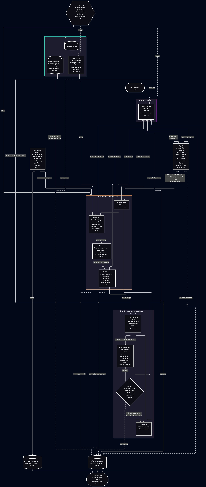
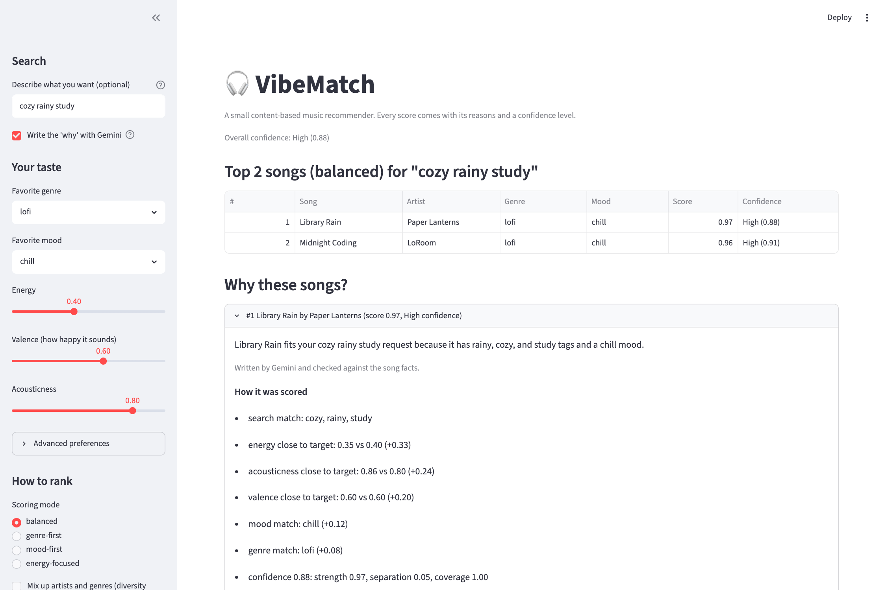

# 🎧 VibeMatch: a music recommender with retrieval, grounded explanations and confidence

VibeMatch recommends songs from a small catalog. You describe your taste with sliders and an optional typed request ("cozy rainy study"). It returns ranked songs, the reasons behind each score, and a **confidence level** that says how far to trust the result. A "why this song" sentence is built from the retrieved song facts, and if an AI model writes it, every word is checked against those facts. If nothing fits, the app says so instead of guessing.

## Original project

This extends my **Module 3 project, the Music Recommender Simulation**. That project loaded 18 songs from a CSV, scored every song against a listener profile (energy, valence and acousticness closeness, plus mood and genre matches), and printed the top results with a plain-English reason for each score. It also gained scoring modes (genre-first, mood-first, energy-focused), a diversity penalty and five extra song features. This project turns it into a small applied AI system: a web UI, keyword retrieval ported from my DocuBot project (the RAG feature), grounded explanations with a validator, confidence scoring, logging and guardrails, and an evaluation harness.

## Architecture overview

The diagram is in [diagrams/architecture.mmd](diagrams/architecture.mmd) (Mermaid source; image: [assets/architecture_mmd.png](assets/architecture_mmd.png)). Data flows like this:



1. **UI** ([app.py](app.py)) collects a typed request and preferences. A command-line version ([src/search.py](src/search.py)) uses the same pipeline.
2. **Input guardrails** check them. Bad input gets a clear message, never a crash.
3. **Retriever** ([src/retrieval.py](src/retrieval.py)) finds songs whose text matches the request. If too few words match, it returns nothing and the UI says "Nothing fits".
4. **Scorer** ([src/recommender.py](src/recommender.py)) ranks the candidates with the chosen mode and an optional diversity penalty.
5. **Confidence** ([src/confidence.py](src/confidence.py)) rates each result.
6. **Explainer** ([src/explain.py](src/explain.py)) writes a "why this song" sentence from the retrieved song facts. With Gemini switched on, the model writes it and a **validator** rejects any sentence that mentions something not in those facts (see below).
7. **Logger** ([src/logging_utils.py](src/logging_utils.py)) writes one line per search to `logs/recommender.log`.
8. **People and tests check the output:** a person reads the table, reasons, confidence and log, and 200 automated tests check each stage.

## Setup

Run these from the project root (the folder containing `app.py`).

```bash
python3 -m venv .venv
source .venv/bin/activate        # Mac or Linux
.venv\Scripts\activate           # Windows
pip install -r requirements.txt
```

## Run

```bash
python -m streamlit run app.py          # web app, usually http://localhost:8501
python -m src.search "cozy rainy study" --profile "Chill Lofi"   # one search in the terminal (add --ai for Gemini)
python -m src.main --table              # terminal view of the demo profiles
python -m pytest                        # all tests (use python -m, not bare pytest)
python -m src.evaluate --brief          # evaluation harness: 19 cases, pass/fail
```

Optional environment variables: `VIBEMATCH_DATA` (path to another song CSV) and `VIBEMATCH_LOG_FILE` (path for the log).

**Optional: Gemini explanations.** Put `GEMINI_API_KEY=your-key` in a `.env` file in the project root (it is gitignored) and tick "Write the 'why' with Gemini" in the sidebar. Without a key everything works; the "why" is built straight from the song facts.

## Reliability: logging, guardrails and confidence

**Logging.** Every search writes one JSON line to `logs/recommender.log` (ignored by git): the query, matched words, mode, result count, top song, confidence, time taken and any error. Load failures are logged too. Logging never raises, so a full disk or a bad path cannot break the app.

```json
{"ts": "2026-11-08T15:17:39+00:00", "event": "search", "query": "cozy rainy study", "matched_words": ["cozy", "rainy", "study"], "mode": "balanced", "diverse": false, "k": 3, "status": "ok", "result_count": 2, "top_title": "Library Rain", "top_confidence": 0.8822, "confidence_label": "High", "elapsed_ms": 0.07, "error": null}
```

**Guardrails** ([src/guardrails.py](src/guardrails.py)):

| Where | What is checked | What the user sees |
|---|---|---|
| Song file | file exists, not empty, has a header and every required column, no duplicate ids, every value has the right type and range (0–1 features, 0–100 popularity, explicit is 0 or 1) | "The song list could not be loaded. Line 7: 'energy' must be between 0 and 1, not 1.5." |
| Typed request | is text, control characters removed, spaces cleaned, at most 200 characters | "Please check your input. Search text is too long." |
| Preferences, k, mode | numbers in range, tags are a list of text, k from 1 to 50, mode exists | "'energy' must be between 0 and 1, not 9." |
| Retrieval | at least 2 request words must match a song (1 for a one-word request) | "Nothing fits: no songs match "xylophone zebra"." |
| Anything unexpected | caught in the pipeline | a short message, with the full error in the log |

**Confidence** ([src/confidence.py](src/confidence.py)). Each result gets a value from 0 to 1 and a label, shown in the table and in each result's reasons:

`confidence = 0.7 × strength + 0.1 × separation + 0.2 × coverage`

- **strength:** the song's score.
- **separation:** how far it leads the next song (a lead of 0.10 or more counts as full).
- **coverage:** the share of typed-request words the song matched. With no request this part is left out and the other two are scaled up.
- **Labels:** High at 0.80 or more, Medium at 0.55 or more, otherwise Low. A Low top result shows a warning. This replaced my earlier fixed "score below 0.6" check.

## Grounded explanations (RAG with validation)

Retrieval first narrows the songs. Then the retrieved text decides what the answer is allowed to say:

1. **Retrieve.** The facts for each song are its searchable description (title, artist, genre, mood, tags, vibe words), plain words for its numbers ("low-energy", "acoustic") and the request words it matched.
2. **Generate.** By default a fact-based template writes the sentence. With Gemini switched on, one API call writes one sentence per result from those facts only. The prompt forbids anything not in the facts.
3. **Validate.** Every word of every sentence must come from that song's facts, the user's own request, or a short list of plain connecting words ("is", "because", "with"). Anything else (an invented genre, year, artist, instrument or number) rejects that sentence, and the fact-based sentence is shown instead, with the reason. A failed or blocked API call falls back the same way.
4. **Keep costs low.** One call per search covers all results, nothing is sent unless the checkbox is ticked, repeated searches are cached, and every call and rejection is logged (the key never is).

Real example, profile Chill Lofi with the request `cozy rainy study` (Library Rain):

| Source | Sentence | Validator |
|---|---|---|
| Fact-based template | It matches your request (cozy, rainy, study) because those words are in its description. It is a lofi song with a chill mood and a low-energy acoustic sound. Its tags are rainy, cozy, study. | accepted |
| Gemini (live call) | Library Rain fits your cozy rainy study request because it has rainy, cozy, and study tags. | accepted |
| Invented text (from a test) | Library Rain is a jazz classic from 1995. | rejected: mentions words not in the song facts: 1995, classic, jazz |

Trade-off: the validator is strict. A harmless synonym ("relaxing" for "chill") is rejected too, which is why the template is always there as a safe fallback. The validator checks words, not meaning, so it cannot catch a sentence that uses allowed words to say something false.

## Sample runs

Everything below is real output, copied from the commands shown. Run them from the project root with the virtual environment active. `python -m src.search` runs the same pipeline as the web app. Its exit code is 0 for results, 1 for "nothing fits", 2 for bad input or a bad song file, and 3 for an unexpected error. `--profile` loads one of the demo listener profiles (Chill Lofi means genre lofi, mood chill, energy 0.4, valence 0.6, acousticness 0.8).

The web app shows the same result. This screenshot has the Gemini option on, and the sentence under the song title passed the validator:



### 1. RAG: a typed request

The request is matched against the song text. Only the two songs that share enough words are kept, ranked by the sliders, with a confidence level and a "why" sentence built from the retrieved facts.

```
$ python -m src.search "cozy rainy study" --profile "Chill Lofi"
Request : cozy rainy study
Prefs   : genre lofi, mood chill, energy 0.4, valence 0.6, acousticness 0.8
Mode    : balanced
Status  : ok, 2 song(s), overall confidence High (0.88)

1. Library Rain by Paper Lanterns  [lofi / chill]
   score 0.97 | confidence High (0.88): strength 0.97, separation 0.05, coverage 1.00
   why: It matches your request (cozy, rainy, study) because those words are in its description. It
        is a lofi song with a chill mood and a low-energy acoustic sound. Its tags are rainy, cozy,
        study. (built from the song facts)
   scored by: search match: cozy, rainy, study; energy close to target: 0.35 vs 0.40 (+0.33);
              acousticness close to target: 0.86 vs 0.80 (+0.24); valence close to target: 0.60 vs
              0.60 (+0.20); mood match: chill (+0.12); genre match: lofi (+0.08)

2. Midnight Coding by LoRoom  [lofi / chill]
   score 0.96 | confidence High (0.91): strength 0.96, separation 1.00, coverage 0.67
   why: It matches your request (cozy, study) because those words are in its description. It is a
        lofi song with a chill mood and a medium-energy acoustic sound. Its tags are study, cozy,
        nocturnal. (built from the song facts)
   scored by: search match: cozy, study; energy close to target: 0.42 vs 0.40 (+0.34); acousticness
              close to target: 0.71 vs 0.80 (+0.23); valence close to target: 0.56 vs 0.60 (+0.19);
              mood match: chill (+0.12); genre match: lofi (+0.08)
[exit code 0]
```

### 2. RAG with Gemini writing the "why"

The same search with `--ai`. One API call writes a sentence per song from the retrieved facts only, and the validator checks every word before it is shown. (Gemini's exact wording can vary between runs; the validator guarantee does not.)

```
$ python -m src.search "cozy rainy study" --profile "Chill Lofi" --ai
Request : cozy rainy study
Prefs   : genre lofi, mood chill, energy 0.4, valence 0.6, acousticness 0.8
Mode    : balanced
Status  : ok, 2 song(s), overall confidence High (0.88)

1. Library Rain by Paper Lanterns  [lofi / chill]
   score 0.97 | confidence High (0.88): strength 0.97, separation 0.05, coverage 1.00
   why: Library Rain fits you because it has the cozy, rainy, and study tags that match your
        request. (written by Gemini, checked against the song facts)
   scored by: search match: cozy, rainy, study; energy close to target: 0.35 vs 0.40 (+0.33);
              acousticness close to target: 0.86 vs 0.80 (+0.24); valence close to target: 0.60 vs
              0.60 (+0.20); mood match: chill (+0.12); genre match: lofi (+0.08)

2. Midnight Coding by LoRoom  [lofi / chill]
   score 0.96 | confidence High (0.91): strength 0.96, separation 1.00, coverage 0.67
   why: Midnight Coding fits you because it has the cozy and study tags that match your request.
        (written by Gemini, checked against the song facts)
   scored by: search match: cozy, study; energy close to target: 0.42 vs 0.40 (+0.34); acousticness
              close to target: 0.71 vs 0.80 (+0.23); valence close to target: 0.56 vs 0.60 (+0.19);
              mood match: chill (+0.12); genre match: lofi (+0.08)
[exit code 0]
```

### 3. Guardrail: nothing fits

Too few request words match any song, so the system refuses to guess.

```
$ python -m src.search "xylophone zebra" --profile "Chill Lofi"
Request : xylophone zebra
Prefs   : genre lofi, mood chill, energy 0.4, valence 0.6, acousticness 0.8
Mode    : balanced
Status  : nothing_fits
Message : Nothing fits: no songs match "xylophone zebra".
[exit code 1]
```

### 4. Reliability: a poor fit is flagged

The catalog has no good match for this listener (metal, peaceful, zero energy). The system still shows the closest songs, but labels the confidence Low and says so.

```
$ python -m src.search --profile "Extreme Targets" -k 3
Request : (none, ranking by preferences only)
Prefs   : genre metal, mood peaceful, energy 0.0, valence 1.0, acousticness 0.0
Mode    : balanced
Status  : ok, 3 song(s), overall confidence Low (0.50)
Warning : low confidence, these are the closest songs, not a good fit

1. Birchwood Lullaby by Moss & Ember  [folk / peaceful]
   score 0.52 | confidence Low (0.50): strength 0.52, separation 0.37, coverage n/a
   why: It is a folk song with a peaceful mood and a low-energy acoustic sound. Its tags are
        peaceful, cozy, dreamy. (built from the song facts)
   scored by: energy close to target: 0.24 vs 0.00 (+0.27); acousticness close to target: 0.93 vs
              0.00 (+0.02); valence close to target: 0.58 vs 1.00 (+0.12); mood match: peaceful
              (+0.12)

2. Velvet Hours by Marisol Kane  [r&b / romantic]
   score 0.48 | confidence Low (0.43): strength 0.48, separation 0.05, coverage n/a
   why: It is an r&b song with a romantic mood and a medium-energy electronic sound. Its tags are
        romantic, smooth, nocturnal. (built from the song facts)
   scored by: energy close to target: 0.49 vs 0.00 (+0.18); acousticness close to target: 0.28 vs
              0.00 (+0.18); valence close to target: 0.62 vs 1.00 (+0.12)

3. Island Sway by Sol Rivera  [reggae / uplifting]
   score 0.48 | confidence Low (0.47): strength 0.48, separation 0.41, coverage n/a
   why: It is a reggae song with an uplifting mood and a medium-energy sound. Its tags are carefree,
        sunny, warm. (built from the song facts)
   scored by: energy close to target: 0.58 vs 0.00 (+0.15); acousticness close to target: 0.31 vs
              0.00 (+0.17); valence close to target: 0.79 vs 1.00 (+0.16)
[exit code 0]
```

### 5. Guardrail: invalid input

An out-of-range preference is rejected with a reason instead of being ranked.

```
$ python -m src.search --profile "Chill Lofi" --energy 9
Request : (none, ranking by preferences only)
Prefs   : genre lofi, mood chill, energy 9.0, valence 0.6, acousticness 0.8
Mode    : balanced
Status  : invalid_input
Message : 'energy' must be between 0 and 1, not 9.
[exit code 2]
```

### 6. Evaluation harness

Nineteen predefined cases run through the same pipeline and are checked against the expected songs, status and confidence (the full table is under Testing summary).

```
$ python -m src.evaluate --brief
P1  PASS  Sunrise City, High (0.96)          High-Energy Pop: the pop/happy song wins
P2  PASS  Library Rain, High (0.85)          Chill Lofi: both lofi/chill songs lead
P3  PASS  Storm Runner, High (0.99)          Deep Intense Rock: the one rock song wins
P4  PASS  Dust Road Home, High (0.99)        Nostalgic Throwback uses decade, popularity and tags
P5  PASS  Adagio for Rain, Medium (0.74)     Sad but Energetic: a compromise, so only Medium confidence
P6  PASS  Birchwood Lullaby, Low (0.50)      Extreme Targets: a poor fit must be flagged Low
P7  PASS  Storm Runner, High (0.84)          Clean Workout: the explicit song stays out of the top 3
M1  PASS  Sunrise City, High (0.97)          Mood-first ranks a happy song above the intense Gym Hero
M2  PASS  Iron Requiem, Medium (0.68)        Genre-first puts the only metal song first for the metal fan
D1  PASS  Library Rain, High (0.95)          Diversity penalty: one song per artist for Chill Lofi
S1  PASS  Library Rain, High (0.88)          'cozy rainy study' finds exactly the two songs with those tags
S2  PASS  Coffee Shop Stories, High (0.82)   A one-word request is enough: 'jazz'
S3  PASS  Gym Hero, High (0.89)              Vibe words from numbers: 'workout powerful'
S4  PASS  Library Rain, High (0.97)          'calm acoustic' returns a full list that includes Library Rain
G1  PASS  nothing_fits                       Nonsense words: nothing fits
G2  PASS  nothing_fits                       One real word and one unknown word: refused
G3  PASS  nothing_fits                       Only filler words: nothing fits
G4  PASS  invalid_input                      Out-of-range energy is rejected with a reason
G5  PASS  invalid_input                      A 500-character request is rejected

19 of 19 cases passed (100%). Average top-result confidence 0.86 across 14 cases that returned songs (High 11, Medium 2, Low 1).
[exit code 0]
```

### 7. Test suite

```
$ python -m pytest -q
........................................................................ [ 35%]
...........................s............................................ [ 71%]
.........................................................                [100%]
200 passed, 1 skipped in 1.34s
[exit code 0]
```

## Design decisions

- **Keyword retrieval, not embeddings.** It is simple, deterministic and testable, and it reuses DocuBot's tokenizer, index and refusal guardrail. The cost: it only finds words that appear in a song's title, artist, genre, mood, tags or a few vibe words, so "relaxing" will not find "relaxed".
- **Retrieval narrows, the scorer ranks.** The sliders decide the order among the songs the request found.
- **Strength dominates confidence.** My first formula (0.6 / 0.2 / 0.2) rated the poor "Extreme Targets" result Medium and punished two great songs for nearly tying. I changed it to 0.7 / 0.1 / 0.2 and left coverage out when there is no request.
- **Strict CSV validation that fails fast.** A bad file stops the app with the line number, which is better than quietly ranking bad data.
- **JSON-lines log.** Easy to read and to parse.
- **Scoring modes are weight tables.** The modes (balanced, genre-first, mood-first, energy-focused) differ only in weights, so one shared scorer reads a table instead of four copies of the math.
- **The AI model is optional and untrusted.** The app works without a key. When Gemini is on, its output is validated word by word and replaced by a fact-based sentence if it fails. I used the standard library for the API call to avoid another dependency.

## Testing summary

All **200 tests pass** (`python -m pytest`), plus 1 live test that is skipped unless `RUN_LIVE_LLM_TESTS=1` (it spends one real API call).

| File | Tests | Covers |
|---|---|---|
| `test_guardrails.py` | 31 | every CSV and input check, with the exact error text |
| `test_pipeline.py` | 18 | statuses, matched words, contained failures, and the content of each log line |
| `test_confidence.py` | 11 | bounds, monotonic behavior, exact values, labels, calibration on the demo profiles |
| `test_retrieval.py` | 22 | stemming, stopwords, expected hits per query, the guardrail on nonsense |
| `test_app.py` | 22 | the Streamlit page (via `AppTest`): results, search box, confidence, error screens |
| `test_explain.py` | 33 | the template, the validator (accepts facts, rejects invented genre, year, artist, instrument, number), the AI step with a fake model (valid, invalid, missing, failing, cached), the client and key loading, and the skipped live test |
| `test_search_cli.py` | 13 | the terminal command: output, exit codes, profiles, flags, the Gemini option with a fake model, a real subprocess run |
| `test_evaluate.py` | 26 | the evaluation harness itself: it passes every built-in case, catches each kind of failure, writes a stable report, updates the README, sets the exit code |
| `test_scoring_modes.py`, `test_diversity.py`, `test_table.py` | 25 | scoring modes, diversity penalty, table output |

Confidence on the 10 demo profiles (no typed request):

| Profile | Top score | Confidence |
|---|---|---|
| High-Energy Pop, Chill Lofi, Deep Intense Rock, Mainstream Hits, Nostalgic Throwback, Instrumental Study Session, Clean Workout | 0.91–0.99 | High |
| Conflicting: Sad but Energetic | 0.71 | Medium |
| Unknown Genre and Mood | 0.72 | Medium |
| Extreme Targets | 0.52 | Low |

### Evaluation harness

`python -m src.evaluate` runs 19 predefined cases (listener profiles, scoring modes, the diversity penalty, typed requests and guardrails) through the real search pipeline. It checks each against what it should return (top song, exact list, songs included or excluded, confidence label, status), prints pass/fail with confidence, writes [reports/evaluation.md](reports/evaluation.md), and exits with code 1 if any case fails. `python -m src.evaluate --readme` refreshes the table below.

<!-- EVAL:START -->
| ID | What it checks | Expected | Result | Top song | Confidence |
|---|---|---|---|---|---|
| P1 | High-Energy Pop: the pop/happy song wins | top = Sunrise City; includes Gym Hero, Rooftop Lights; confidence High; grounded explanations | PASS | Sunrise City | High (0.96) |
| P2 | Chill Lofi: both lofi/chill songs lead | includes Library Rain, Midnight Coding; confidence High | PASS | Library Rain | High (0.85) |
| P3 | Deep Intense Rock: the one rock song wins | top = Storm Runner; confidence High | PASS | Storm Runner | High (0.99) |
| P4 | Nostalgic Throwback uses decade, popularity and tags | top = Dust Road Home; confidence High | PASS | Dust Road Home | High (0.99) |
| P5 | Sad but Energetic: a compromise, so only Medium confidence | top = Adagio for Rain; confidence Medium | PASS | Adagio for Rain | Medium (0.74) |
| P6 | Extreme Targets: a poor fit must be flagged Low | top = Birchwood Lullaby; confidence Low | PASS | Birchwood Lullaby | Low (0.50) |
| P7 | Clean Workout: the explicit song stays out of the top 3 | top = Storm Runner; excludes Iron Requiem | PASS | Storm Runner | High (0.84) |
| M1 | Mood-first ranks a happy song above the intense Gym Hero | Rooftop Lights above Gym Hero | PASS | Sunrise City | High (0.97) |
| M2 | Genre-first puts the only metal song first for the metal fan | top = Iron Requiem | PASS | Iron Requiem | Medium (0.68) |
| D1 | Diversity penalty: one song per artist for Chill Lofi | max 1 per artist | PASS | Library Rain | High (0.95) |
| S1 | 'cozy rainy study' finds exactly the two songs with those tags | exactly Library Rain, Midnight Coding; confidence High; grounded explanations | PASS | Library Rain | High (0.88) |
| S2 | A one-word request is enough: 'jazz' | exactly Coffee Shop Stories | PASS | Coffee Shop Stories | High (0.82) |
| S3 | Vibe words from numbers: 'workout powerful' | exactly Gym Hero | PASS | Gym Hero | High (0.89) |
| S4 | 'calm acoustic' returns a full list that includes Library Rain | includes Library Rain; grounded explanations | PASS | Library Rain | High (0.97) |
| G1 | Nonsense words: nothing fits | nothing_fits | PASS | - | - |
| G2 | One real word and one unknown word: refused | nothing_fits | PASS | - | - |
| G3 | Only filler words: nothing fits | nothing_fits | PASS | - | - |
| G4 | Out-of-range energy is rejected with a reason | invalid_input; message has ''energy' must be between 0 and 1' | PASS | - | - |
| G5 | A 500-character request is rejected | invalid_input; message has 'too long' | PASS | - | - |

19 of 19 cases passed (100%). Average top-result confidence 0.86 across 14 cases that returned songs (High 11, Medium 2, Low 1).
<!-- EVAL:END -->

The expected results were written from behavior I had already inspected, so this harness guards against regressions and checks the guardrails. It is not an independent measure of recommendation quality.

What worked: breaking the code on purpose made tests fail (weakening the confidence weights failed 7 tests, and removing the CSV range check failed 1). What I learned: my first confidence formula looked fine until I ran it on the adversarial profiles.

## Limitations

- Only 18 songs, and I wrote the mood tags by hand.
- The confidence weights and thresholds were tuned by looking at the same 10 demo profiles used in the tests, so they are not independently validated. Confidence says how well the catalog fits the request, not whether you will like the song.
- Retrieval needs exact words (after light stemming).
- The validator checks words, not meaning, and is strict about synonyms (see the RAG section).

## Reflection

Building this taught me that the AI part of a system is the smallest and least trustworthy part, so most of the work is around it: deciding what the model may see, checking what it says, and having a safe answer ready when it fails. Retrieval turned out to be a design problem, not a model problem: what the song text contains decides what can be found. I also learned to test by breaking things on purpose. Several of my first guesses (the confidence formula, the strictness of the validator) only looked right until I ran them on the awkward cases. My responsible-AI reflection (limitations, misuse, and how I worked with AI) is in [model_card.md](model_card.md).
